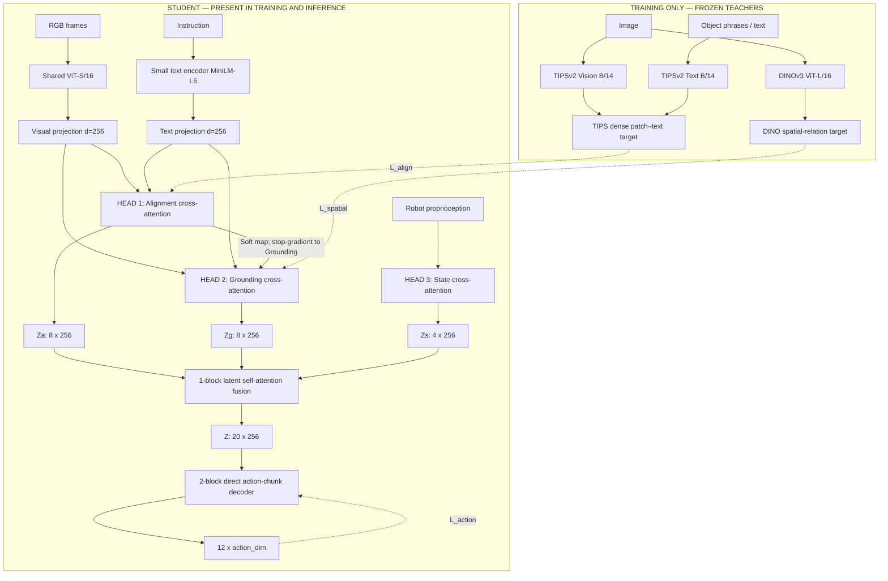
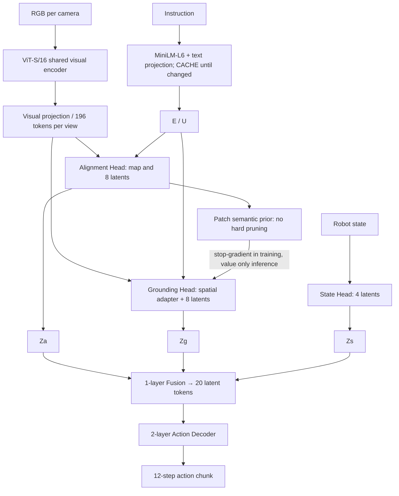

# TIPS-Ground-VLA — Đặc tả kiến trúc chi tiết (Architecture Specification)

**Phiên bản:** 1.0 · **Ngày:** 2026-10-13  
**Trạng thái:** Thiết kế đề xuất để triển khai; **chưa phải** kiến trúc đã được huấn luyện và kiểm nghiệm.  
**Đối tượng:** Coding agent / research engineer.  
**Phạm vi:** Đặc tả **mô hình**, giao diện tensor, các mô-đun, kiến thức teacher, loss, đồ thị gradient, lịch train và đồ thị suy luận. **Không quy định** framework, thư viện, hệ điều hành, cách chia repo, API máy chủ hay phần cứng.

> **Quyết định thiết kế không được tự ý thay đổi trong bản v1:** Đây là mô hình VLA **độc lập, không phụ thuộc TurboVLA**; có **đúng ba specialized attention heads** (Alignment, Grounding, Robot State); backbone vision của **student là ViT-S/16**, **không phải DINO**; chỉ trong training mới sử dụng **TIPSv2-B/14 (vision + text)** và **DINOv3 ViT-L/16 (vision)** làm frozen teachers; học latent `Z` gồm **20 token × 256 chiều**; decoder sinh trực tiếp **action chunk 12 bước trong một lần forward**. Không bổ sung dynamics head, segmentation head, diffusion policy hoặc language-model planner vào v1.

---

## 0. Cách đọc đặc tả và mức độ bắt buộc

- **MUST / BẮT BUỘC:** ràng buộc hình dạng tensor, đường truyền dữ liệu, masking, objective chính; sai sẽ làm mô hình khác thiết kế hoặc học sai.
- **DEFAULT / MẶC ĐỊNH:** một cấu hình triển khai cụ thể để agent không cần chọn thêm. Có thể thay **sau khi đã có bản v1 chạy đúng**.
- **OPTIONAL / TÙY CHỌN:** chỉ kích hoạt nếu dữ liệu/hạ tầng cung cấp, **không phải** điều kiện để chạy v1.
- **TEACHER** là mạng cung cấp supervision trong training; **STUDENT** là mạng có mặt khi inference.
- “Grounding” ở v1 gồm **language-conditioned spatial representation**. DINO distillation **không tự nó tạo** referring detection/segmentation chuẩn. Muốn nói ground-truth localization thì phải có nhãn bbox/mask/point hoặc teacher localization đủ tin cậy. Đây là giới hạn khoa học quan trọng.

**Mục tiêu ưu tiên theo thứ tự:** (1) policy học và hoàn thành hành động tốt; (2) ổn định khi huấn luyện; (3) gọn, ít thành phần; (4) giảm latency để chạy edge. Do đó **không** prune visual tokens hoặc ép `Z` thành một vector duy nhất trong v1.

## 1. Tầm nhìn kiến trúc

Mô hình học ba loại biểu diễn bổ sung:

1. **WHAT — Alignment Head:** patch nào trong ảnh khớp với đối tượng/cụm từ của instruction? Distill patch–text relation từ TIPSv2.
2. **WHERE — Grounding Head:** cấu trúc và quan hệ không gian cục bộ của các patch là gì, đặc biệt quanh các vùng liên quan tới instruction? Distill quan hệ dense visual features từ DINOv3, có điều kiện từ text và soft map của Alignment Head.
3. **STATE — State Head:** robot đang ở trạng thái gì (joints, EEF, gripper...), tách biệt với thị giác và được tối ưu trực tiếp qua action loss.

Ba head sinh `Za`, `Zg`, `Zs`, hợp thành `Z ∈ R^{B×20×256}`, cho action decoder dự đoán một chunk `[a_t, …, a_{t+11}]` không dùng autoregressive generation, diffusion hay một LLM.

### 1.1 Sơ đồ tổng thể, đúng ba specialized heads



**Chú giải:** mũi tên đứt là đường supervision/loss; các teacher không nằm trong inference graph. `Robot State Head` không đi qua Shared Vision. `MiniLM-L6` là **student text encoder** chạy khi suy luận (có thể cache theo instruction), không phải TIPS text teacher.

### 1.2 Phân biệt “3 heads” với `multi_head_attention`

**Ba specialized heads** là ba nhánh **có tham số, query và mục tiêu học độc lập**:

- `AlignmentHead`: một khối **cross-attention 4 attention sub-heads nội bộ**, 8 latent queries.
- `GroundingHead`: một khối **cross-attention 4 attention sub-heads nội bộ**, 8 latent queries.
- `StateHead`: một khối **cross-attention 4 attention sub-heads nội bộ**, 4 latent queries.

Tức là **3 module chuyên biệt**, mỗi module dùng **MHA 4 sub-heads**, **không phải** thiết lập một `MultiheadAttention(num_heads=3)` rồi hi vọng từng sub-head tự học ba nhiệm vụ. Điều này là một quyết định kiến trúc cốt lõi.

---

## 2. Ký hiệu và các bất biến hình dạng

| Ký hiệu | Nghĩa | Default |
|---|---|---|
| `B` | batch size | biến đổi |
| `C` | số camera/views | `1`, hỗ trợ `2+` bằng cùng giao diện |
| `H_img, W_img` | kích cỡ ảnh đầu vào student | `224, 224` |
| `p_v` | student patch size | `16` |
| `H_p,W_p` | grid student | `14,14` |
| `N` | số patch / view | `196` |
| `N_all` | patch từ mọi camera | `C × 196` |
| `d_v` | hidden dim ViT-S/16 student | `384` |
| `d_t` | hidden dim MiniLM-L6 student | `384` |
| `d` | chiều làm việc chung sau projections | `256` |
| `L` | text token count, đã pad/mask | `≤64` |
| `P` | số object/referent phrases dùng cho dense VL loss | `1..4`, mặc định target **tối đa 4** |
| `K_a` | Alignment latent queries | `8` |
| `K_g` | Grounding latent queries | `8` |
| `K_s` | State latent queries | `4` |
| `K` | Unified latent tokens | `20 = 8+8+4` |
| `h` | attention sub-heads mỗi specialized/fusion/decoder attention | `4` |
| `d_k` | dimension mỗi attention sub-head | `64 = 256/4` |
| `d_ff` | kích thước feed-forward hidden | `1024` |
| `H_a` | độ dài action chunk | `12` |
| `D_s` | chiều trạng thái robot sau nối các nhóm | lấy từ embodiment |
| `D_a` | action vector mỗi bước | lấy từ embodiment, ví dụ `7` |

**Tensor layout chuẩn:** `B` đầu tiên; nếu nhiều camera, giữ `C` trước patch trong mọi loss, chỉ flatten `C×N` để cross-attention đọc các view cùng lúc. Image dùng `I ∈ R^{B×C×3×224×224}`; một camera vẫn có `C=1` (không âm thầm bỏ chiều camera).

### 2.1 Hình dạng mẫu end-to-end

Ví dụ `B=2, C=2, L=32, P=2, D_a=7`:

| Tín hiệu | Shape |
|---|---|
| Images | `[2, 2, 3, 224, 224]` |
| Student ViT patch features trước projection | `[2, 2, 196, 384]` |
| Student projected visual tokens `F` | `[2, 2, 196, 256]` |
| Flatten visual KV `F_flat` | `[2, 392, 256]` |
| Student instruction text tokens `E` | `[2, 32, 256]` |
| Student phrase embeddings `U` | `[2, 2, 256]` |
| TIPS teacher patch tokens | `[2, 2, 256, 768]` |
| TIPS teacher phrase vectors | `[2, 2, 768]` |
| TIPS teacher aligned supervision `P_T` | `[2, 2, 2, 196]` (sau grid resize) |
| Alignment student similarity distribution `P_S` | `[2, 2, 2, 196]` |
| DINO teacher patch tokens | `[2, 2, 196, D_DINO]`; `D_DINO=1024` với ViT-L/16 được chọn |
| Student grounding dense map `G` | `[2, 2, 196, 256]` |
| Per-view DINO/student relation matrix | `[2, 2, 196, 196]` |
| Alignment latent `Za` | `[2, 8, 256]` |
| Grounding latent `Zg` | `[2, 8, 256]` |
| State latent `Zs` | `[2, 4, 256]` |
| Concatenated and fused `Z` | `[2, 20, 256]` |
| 12 action queries | `[2, 12, 256]` |
| Output action chunk | `[2, 12, 7]` |

**Không được** nhầm `[P]` (số cụm từ) với `[L]` (token từ tokenizer) và `[N]` (số visual patches). TIPS `encode_text` cho một **embedding / text query**; không mặc định có một vector khớp patch cho **mỗi subword**.

---

## 3. Student Shared Vision Backbone: ViT-S/16

### 3.1 Chỉ một backbone vision trong inference

Cấu hình **DEFAULT**: **pretrained ViT-S/16**, không dùng DINO làm backbone. ViT-S/16 là lựa chọn kiến trúc (12 Transformer blocks, patch 16, hidden 384, 6 native attention heads, MLP expansion 4×). Weights initialization có thể lấy từ bất kỳ checkpoint ViT-S/16 pretrained tương thích; teacher DINO không phải là student model.

| Tham số | Giá trị |
|---|---|
| Input | RGB `[B,C,3,224,224]` |
| Patch embedding | 16×16 không overlap |
| Patch grid | 14×14 |
| Patch token count | 196 per camera |
| ViT depth | 12 transformer encoder blocks |
| ViT hidden | 384 |
| ViT native attention heads | 6 |
| ViT native MLP ratio | 4 (`1536` hidden) |
| Pretrained CLS | có thể đi qua transformer theo checkpoint; **loại CLS khỏi dense patch output** |
| Pretrained register tokens (nếu có) | loại khỏi patch output và tính đúng offset |
| Positional encoding | giữ logic pretrained / nội suy nếu checkpoint có grid khác |
| Output projection | `Linear(384,256)` → `LayerNorm(256)` |
| Final output | `F ∈ R^{B×C×196×256}` |

**Chi tiết bắt buộc:** lấy **196 patch tokens**, không đưa `CLS` thành một patch; không flatten nhầm không gian patch trước khi lưu grid. Tọa độ patch là row-major `(y,x)` với `idx=y*14+x` để map của teacher align đúng ảnh. Camera ID được cộng vào `F` bằng một learned embedding `[C_max,256]` **sau** visual projection; không thêm lớp encoder riêng cho từng camera. Tất cả camera chia sẻ ViT weights.

**Quan điểm performance:** giữ nguyên 196 patches/view lúc inference v1. Không hard pruning bởi teacher similarity vì robot còn cần gripper, vị trí đích và vật cản không được nhắc trong lệnh.

### 3.2 Multi-camera, biến hình học ảnh và masks

- Nếu `C>1`, chạy cùng ViT cho từng camera; kết quả `[B,C,N,256]`, flatten thành `[B,CN,256]` **chỉ trong cross-attention**.
- Lưu `view_valid_mask ∈ {0,1}^{B×C}`; mất camera phải mask **toàn bộ N tokens** của view đó khỏi K/V và tất cả losses, không zero token rồi coi là valid.
- Mỗi teacher xử lý **đúng cùng vùng ảnh** tương ứng với student theo hình học. Nếu resize/crop/flip, teacher logits phải được remap đúng patch centers vào student coordinates. Đơn giản và ít lỗi nhất ở v1: cùng view, cùng crop và fixed 224×224 cho student/teachers; khác normalization theo teacher riêng.
- Nếu camera khác calibration, v1 không giả định có 3D metric geometry; dùng view embeddings và relationship per-view. Không suy từ 2D similarity ra world coordinates.

---

## 4. Student Text Encoder

**DEFAULT:** MiniLM-L6, token hidden width `384`, 6 Transformer layers, đầu ra **token-level hidden states**; `Linear(384,256)` + `LayerNorm(256)` cho text tokens. Không dùng một embedding câu duy nhất thay cho toàn bộ token sequence trong Alignment Head.

```text
Instruction q (max L=64 tokens)
    → MiniLM-L6 token states [B,L,384]
    → text projection + LayerNorm
    → E [B,L,256] + attention_mask [B,L]

Object phrases {q1,...,qP}
    → cùng MiniLM, encode độc lập hoặc trích theo token spans khi xác định rõ
    → masked mean pool trên token hợp lệ
    → phrase projection
    → U [B,P,256], phrase_valid_mask [B,P]
```

- **Phrases:** mục đích là các noun phrases/referents như `"red cup"`, `"blue bowl"`. Dữ liệu cung cấp phrase list là interface; không áp đặt parser/NLP framework. Tối đa `P=4`. Nếu dataset không có phrase labels, fallback `P=1` với full instruction **vẫn chạy**, nhưng không khẳng định tạo localization target tốt như dùng noun phrases.
- **Text normalization:** student và TIPS teacher có tokenizer/normalization độc lập; cả hai phải nhận cùng ngữ nghĩa phrase, không yêu cầu token IDs giống nhau.
- **Padding:** mọi attention qua `E` bỏ padding tokens; mean pooling phrase bỏ padding; phrases invalid không tham gia KL.
- **Cache:** ở inference, nếu instruction không đổi, `E` và `U` được tính **một lần** rồi tái sử dụng; đổi instruction phải invalidate cả hai. Teacher text không hiện diện ở inference.
- **Fine-tuning default:** freeze MiniLM backbone ở warm-up, giữ frozen trong action fine-tuning v1; train text projections và các attention query conditioning. Nhờ vậy projection được học trong khi backbone text vẫn ổn định.

---

## 5. Teacher 1: TIPSv2-B/14 (bắt buộc dùng CẢ vision + text)

### 5.1 Thành phần và phạm vi

- **TIPSv2 Vision Teacher:** ViT-B/14, `768`-dim patch embeddings.
- **TIPSv2 Text Teacher:** Transformer text tower cùng checkpoint, text embedding `768`.
- Cả hai **frozen, eval, không gradient** ở mọi giai đoạn training.
- Cả hai chỉ được dùng để **tạo patch–text similarity targets**, không copy một cách mù quáng từng vector 768-d vào student 256-d.

Với ảnh **224×224** và patch size 14:

```text
V_TIPS ∈ R[B,C,16*16,768] = R[B,C,256,768]
T_TIPS ∈ R[B,P,768]
```

Mỗi patch embedding và phrase embedding được chuẩn hóa L2 trên chiều feature:

\[
\hat V_{b,c,i}=V_{b,c,i}/\max(\|V_{b,c,i}\|_2,\epsilon), \quad
\hat T_{b,p}=T_{b,p}/\max(\|T_{b,p}\|_2,\epsilon).
\]

Teacher similarity logits:

\[
S^T_{b,c,p,i}=\langle\hat V_{b,c,i},\hat T_{b,p}\rangle
\quad\text{shape }[B,C,P,256].
\]

### 5.2 Quy trình regrid **16×16 → 14×14** chính xác

1. Reshape teacher similarity **logits** `S_T` thành `[B,C,P,16,16]`.
2. Bilinear interpolate **logits** trên spatial grid sang `[B,C,P,14,14]` (`align_corners=False` nếu dùng convention pixel centers chuẩn); không nội suy teacher patch vector sau khi flatten và không dùng 256→196 reshape đơn thuần.
3. Flatten row-major thành `[B,C,P,196]`.
4. Áp mask invalid views/phrases; softmax **trên 196 patches của từng view và phrase** với temperature `τ_align_T=0.07`:

\[
P^T_{b,c,p,i}=\operatorname{softmax}_{i}\big(\tilde S^T_{b,c,p,i}/0.07\big).
\]

5. `P_T` là **soft teacher supervision**; có thể có nhiều vùng kích hoạt, không phải mask segmentation có ground truth.

**Lý do regrid logits trước softmax:** phân phối patch teacher và student có lưới khác nhau; softmax trên lưới 256 rồi nội suy xác suất sang 196 dễ làm thay đổi tổng khối lượng xác suất. Làm chuẩn hóa **sau** regrid đơn giản, nhất quán.

### 5.3 TIPS tạo gì và không tạo gì

TIPSv2 dạy **mức liên hệ ngữ nghĩa giữa vùng ảnh và phrase**. Nó **không** bảo đảm phân biệt hoàn hảo hai vật thể cùng class, không bảo đảm toạ độ grasp 3D, không thay thế nhãn object detection. Ví dụ phrase `"cup"` có thể kích hoạt cả hai chiếc cốc; nếu cần phân biệt `"left red cup"` với `"right red cup"`, cần language-conditioned grounding học thêm từ action data/nhãn bổ sung.

---

## 6. Teacher 2: DINOv3 ViT-L/16 (vision-only; không phải student backbone)

**DEFAULT:** frozen DINOv3 ViT-L/16 teacher, patch size 16, dense patch features (thường `1024` dim). Teacher chỉ cung cấp **cấu trúc tương quan giữa các visual patches**. Teacher không đọc text và không sinh bbox/mask theo câu lệnh.

Với ảnh 224×224:

```text
D_T ∈ R[B,C,196,D_DINO]
D_DINO = 1024 với cấu hình teacher ViT-L/16 đã chọn
```

- Phải loại CLS/register tokens khỏi dense token sequence; nếu checkpoint/API trả token đặc biệt thì số vị trí patch vẫn phải là **196**.
- Mỗi camera tự có `196×196` relation matrix; **không tính** tương quan teacher giữa patch của camera A và patch của camera B trừ khi teacher có cơ chế cross-view riêng (v1 không có).
- Chuẩn hoá L2 các patch features rồi tạo cosine affinity:

\[
R^T_{b,c,i,j}=\langle\hat D^T_{b,c,i},\hat D^T_{b,c,j}\rangle
\quad\in\mathbb{R}^{B\times C\times196\times196}.
\]

Để dùng KL distribution matching, đặt diagonal `i=j` không hợp lệ (hoặc âm vô cùng trước softmax) vì self-similarity bằng 1 sẽ thống trị; sau đó áp softmax theo `j`, nhiệt độ `τ_spatial=0.10`:

\[
P^{DINO}_{b,c,i,j}=\operatorname{softmax}_{j\neq i}(R^T_{b,c,i,j}/0.10).
\]

Đây là **spatial-structure teacher**, không phải grounding detector. Không gọi `P_DINO` là xác suất mask hoặc tọa độ thật.

---

## 7. Chuẩn khối Attention sử dụng ở các head/fusion/decoder

Mỗi phép multi-head attention ở chiều `d=256` có `h=4`, `d_k=64`:

\[
\operatorname{Attention}(Q,K,V;B)=\operatorname{Concat}_{r=1}^{4}
\left[\operatorname{softmax}\left(\frac{QW_Q^{(r)}(KW_K^{(r)})^\top}{\sqrt{64}}+B+M\right)VW_V^{(r)}\right]W_O
\]

`B` là optional semantic attention bias, `M` là padding/view mask; không được trộn chúng một cách gây `NaN`. Nếu toàn bộ camera views invalid, sample phải bị loại/flag, không softmax toàn `-∞`.

Khối chuẩn `CrossAttentionBlock(Q, KV)`:

1. `Q0` queries `[B,K,d]`; `KV` tokens `[B,N_k,d]`.
2. `Q1 = Q0 + MHA(LN(Q0), LN(KV), LN(KV), bias, mask)`.
3. `Y = Q1 + FFN(LN(Q1))`.
4. `FFN`: `Linear(256,1024) → GELU → Linear(1024,256)`.
5. Dropout `0.0` là default v1 để đơn giản và giữ latency; nếu muốn regularization, thử sau. LayerNorm epsilon `1e-5`.
6. **Mỗi specialized head có Q/K/V/output projection và FFN riêng; tuyệt đối không share attention weights giữa Alignment và Grounding.**

Latent slots `K` là **queries học được**, không phải đồng nghĩa với 196 patch features. Dense teacher losses phải giám sát **dense student feature/map** trước bước nén từ patch tokens sang latent queries; không thể áp patch-level loss lên `Za` 8 slots và gọi đó là patch alignment.

---

## 8. Specialized Head 1 — Alignment Head (`WHAT`)

### 8.1 Nhiệm vụ và outputs bắt buộc

Nhận **projected student visual patches** `F` và **student text** `E/U`; xuất:

1. `S_S`: cosine similarity logits patch↔phrase `[B,C,P,196]`, dành cho distillation và attention prior.
2. `P_S`: patch probability distribution `[B,C,P,196]`, dành cho KL và Grounding conditioning.
3. `Za`: **8** language-conditioned latent tokens `[B,8,256]`, dành cho latent fusion và action.

`AlignmentHead` chịu gradient từ `L_align` và từ `L_action` qua `Za`. Không có teacher ở deployment.

### 8.2 Thành phần bên trong

| Thành phần | Shape / parameters |
|---|---|
| Patch semantic projection | `Linear(256,256)` + `LayerNorm(256)` |
| Phrase semantic projection | `Linear(256,256)` + `LayerNorm(256)` |
| Similarity temperature | `τ_align_S=0.07` fixed v1 |
| Base learned queries `Q_A` | `[8,256]` |
| Text-to-query conditioning | `Linear(256,256)` tác động vào masked-mean-pooled `E` rồi broadcast trên 8 queries |
| Cross-attention | `d=256`, `4` internal heads, `head_dim=64`, **1 block** |
| Attention KV | tất cả valid visual tokens `F_flat [B,C*196,256]` |
| Attention bias strength | `β_A=0.5` (fixed v1) |
| FFN | `256 → 1024 → 256`, GELU |
| Output | `Za [B,8,256]` |

### 8.3 Patch–phrase relation: tính trước latent compression

Với mỗi patch i, phrase p:

\[
\tilde f^a_{b,c,i}=\operatorname{L2Norm}(W_{Av}F_{b,c,i}),\quad
\tilde u^a_{b,p}=\operatorname{L2Norm}(W_{At}U_{b,p}),
\]

\[
S^S_{b,c,p,i}=\langle\tilde f^a_{b,c,i},\tilde u^a_{b,p}\rangle,
\quad
P^S_{b,c,p,:}=\operatorname{softmax}_{i}(S^S_{b,c,p,i}/0.07).
\]

Khi `P=2` (source/destination), bảo toàn **hai** map riêng cho `L_align`. Chỉ sau đó mới tổng hợp thành semantic prior cho query attention:

\[
\bar P^S_{b,c,i}=\frac{1}{P_{valid}}\sum_{p\;valid}P^S_{b,c,p,i}.
\]

Mỗi view có phân phối chuẩn hóa `Σ_i \bar P_i=1`. Trước khi sử dụng làm additive log-bias, scale với số patch để nền uniform có bias bằng 0:

\[
b^A_{b,c,i}=\operatorname{clip}\big(\beta_A\log(196\bar P^S_{b,c,i}+10^{-6}),\; -2,\;+2\big).
\]

Bias `[B,C*196]` được broadcast cho 8 queries và 4 sub-heads. **Không** hard-mask theo threshold: vùng xung quanh object và gripper vẫn được nhìn thấy qua các token và có gradient.

### 8.4 Cross-attention của Alignment Head

1. `t_pool=MaskedMean(E, text_valid_mask) ∈ R[B,256]`.
2. `Qa=Q_A[None,:,:] + Linear_A(t_pool)[:,None,:]` có shape `[B,8,256]`.
3. `Za=CrossAttentionBlock(Qa,F_flat,bias=b_A,view_token_mask)`.
4. `Za` nhận biết ngôn ngữ vì **queries và patch prior được điều kiện hóa bởi text**, không chỉ vì text embeddings được nối ở cuối.

**Đường gradient:** `L_align → W_Av,W_At → F,U` và, nếu backbone unfreeze, → shared ViT/text projections; `L_action → Za → cross-attention, F, E` và → `W_Av/W_At` qua attention prior. Không cần target supervision trực tiếp trên `Za`: target là **patch similarity map**, còn `Za` được học để phục vụ action.

### 8.5 Alignment loss (chính xác về chiều tính)

Dùng per-phrase/per-view KL với teacher làm phân phối target:

\[
L_{align}=\frac{1}{|\mathcal V|}\sum_{(b,c,p)\in\mathcal V}\sum_{i=1}^{196}
P^T_{b,c,p,i}\log\frac{P^T_{b,c,p,i}+\epsilon}{P^S_{b,c,p,i}+\epsilon}.
\]

`V` chứa **valid** `(batch, camera, phrase)` triplets. Không KL qua `P` dimension (nghĩa là không buộc các phrase tranh xác suất với nhau), chỉ KL qua spatial patch dimension `196`. Nếu `|V|=0`, skip loss cho minibatch và flag dữ liệu lỗi.

**Không dùng `P_T` như hard segmentation mask**, không chuyển thẳng score sang box. Đây là alignment knowledge distillation đúng với bản chất TIPSv2.

---

## 9. Specialized Head 2 — Grounding Head (`WHERE`)

### 9.1 Nhiệm vụ và outputs

Nhận `F` từ student ViT, language tokens `E`, **soft patch prior** `P_S` từ Alignment Head (đã stop-gradient ở nhánh này). Xuất:

1. Dense grounded features `G ∈ R^{B×C×196×256}`: dùng để học quan hệ giữa các patch từ DINO teacher.
2. `Zg ∈ R^{B×8×256}`: task-conditioned spatial latent để fuse với `Za`/`Zs`.

**Tối thiểu phải có cả hai đầu ra.** Nếu chỉ có 8 latent query vectors mà không có `G` dense thì không thể làm patch×patch relation distillation theo teacher. Nếu chỉ có dense map mà không có `Zg`, không theo đúng kiến trúc latent 3-head.

### 9.2 Dense spatial adapter (trước attention)

Input `F` chuyển grid `[B*C,14,14,256]` hoặc equivalent channel-first. Sử dụng **hai residual depthwise-separable convolution blocks** độc lập với Alignment Head.

Mỗi block:

1. Depthwise convolution 3×3, stride 1, padding giữ 14×14, groups=256, đầu ra 256 channels.
2. Pointwise convolution 1×1, `256→256`.
3. GELU, LayerNorm trên chiều channel (theo layout thích hợp).
4. Residual skip trên 256-channel input.

Sau block thứ hai:

\[
G=SpatialAdapter(F)\in\mathbb{R}^{B\times C\times196\times256}.
\]

Không downsample thêm grid; không thêm FPN, detector hay decoder segmentation nặng vào v1. Các conv học cấu trúc local, còn attention queries học task-conditioned aggregation.

### 9.3 Teacher spatial-relation distillation

Student relation:

\[
R^S_{b,c,i,j}=\left\langle
\frac{G_{b,c,i}}{\max(\|G_{b,c,i}\|_2,\epsilon)},
\frac{G_{b,c,j}}{\max(\|G_{b,c,j}\|_2,\epsilon)}
\right\rangle.
\]

Bỏ diagonal và softmax trên `j` với `τ_spatial=0.10`, nhận `P^S_spatial [B,C,196,196]`.

\[
L_{spatial}=\frac{1}{|\mathcal C|\cdot196}
\sum_{(b,c)\in\mathcal C}\sum_{i=1}^{196}
KL\big(P^{DINO}_{b,c,i,:}\;\|\;P^{S}_{spatial,b,c,i,:}\big).
\]

Trong đó `C` là valid camera views. Mỗi hàng 196×196 được normalise **trên các vị trí j≠i**. Bản v1 không dùng raw MSE giữa teacher `1024` và student `256` vì khác chiều representation, dễ bất ổn và không trực tiếp bảo toàn quan hệ patch–patch.

### 9.4 Grounding Head được condition theo language như thế nào?

DINO **không có text**, nên `L_spatial` một mình chỉ dạy **structure**, không thể dạy chọn `"red cup"` thay vì `"blue cup"`. Để Grounding Head không biến thành spatial encoder vô điều kiện, áp hai loại conditioning **không tạo head mới**:

**(A) Text-conditioned queries**

\[
Q_g=Q_G+W_{Gt}\cdot t_{pool}\quad\text{broadcast sang }8\text{ queries},
\]

trong đó `Q_G ∈ R^{8×256}` học được, `W_Gt:256→256`, `t_pool=MaskedMean(E)`.

**(B) Semantic attention prior từ Alignment Head**

\[
b^G_{b,c,i}=\operatorname{clip}\big(0.5\log(196\cdot\operatorname{stopgrad}(\bar P^S_{b,c,i})+10^{-6}),-2,2\big).
\]

`stopgrad` trên patch prior là **bắt buộc ở v1**: gradient của spatial teacher loss không đẩy trực tiếp Alignment Head qua đường conditioning này. Nhờ đó teacher TIPS và DINO có không gian tối ưu chuyên biệt hơn.

Sau đó:

\[
Z_g=CrossAttentionBlock(Q_g,\operatorname{FlattenViews}(G),\;bias=b^G,\;viewmask).
\]

**Không lấy `Za` làm đầu vào `Qg` trong v1**: tránh coupling ngầm làm `L_spatial` huấn luyện chéo Alignment Head. Grounding vẫn language-conditioned qua `E` và TIPS semantic prior qua `P_S`.

### 9.5 Giới hạn nghĩa “grounding”

- Có: spatial feature structure + text-conditioned pooling + target-region soft guidance.
- **Chưa bảo đảm:** chính xác `bbox`, instance mask, pose, 3D depth, object tracking, open-set referring accuracy.
- Nếu sau này có nhãn tọa độ/referring mask, bổ sung auxiliary `L_localization` **trên dense output của chính Grounding Head** (không tạo head thứ tư). Nhưng **không bắt buộc** và **không nằm trong loss mặc định v1**.
- Vì sao hợp lý: mô hình cuối vẫn phải dự đoán action chính xác, nên `L_action` là supervision cuối để chọn spatial knowledge hữu dụng; không cần xuất bbox/mask tại inference.

---

## 10. Specialized Head 3 — Robot State Head (`STATE`)

### 10.1 State không đi qua ViT

Trạng thái proprioception là input riêng. Có thể bao gồm (theo dữ liệu robot):

- joint positions `q_t`;
- joint velocities `qdot_t`;
- end-effector pose (position + orientation) trong frame thống nhất;
- gripper opening/state;
- optional previous executed action (chỉ nếu luôn sẵn có trong train/inference).

`D_s` **không được hardcode** (robot khác nhau dùng state khác nhau). Các field và unit/frame convention phải được định nghĩa trong embodiment input contract. Mọi scalar/state group dùng **statistics từ tập train** để normalization; không fit normalization lên validation/test.

### 10.2 Tạo state tokens để attention không thoái hóa

Lỗi cần tránh: đưa **một** state token vào cross-attention có `K,V` length 1 sẽ làm attention weights luôn bằng 1, không còn chọn được state source. Vì vậy trong v1, **State Head phải có 4 state source tokens**:

| State source token | Nội dung mặc định | Shape sau projection |
|---|---|---|
| `s_1` | robot joints position | `[B,1,256]` |
| `s_2` | robot joints velocity (hoặc zero+valid mask) | `[B,1,256]` |
| `s_3` | EEF position+orientation | `[B,1,256]` |
| `s_4` | gripper status (+previous action nếu contract quy định) | `[B,1,256]` |

Mỗi nhóm: `Linear(D_group,128) → GELU → Linear(128,256) → LayerNorm(256)`. Mỗi nhóm có parameters riêng và learned **group-type embedding** 256 chiều.

- Thiếu nhóm đầu vào: gán invalid mask và bỏ nhóm khỏi K/V, không coi zero được normalise là dữ liệu thật.
- Nếu dataset chỉ có một vector proprioception **không tách được semantics**, fallback **được quy định rõ**: `StateMLP(D_s→128→4*256)`, reshape `[B,4,256]` và 4 learned slot-ID embeddings; lúc này 4 key/value tokens thực sự khác nhau. Chỉ dùng fallback này nếu không có schema nhóm.
- Tối thiểu một valid state source hoặc một valid flattened-state vector; nếu không, sample không hợp lệ cho policy này.

### 10.3 State cross-attention

- `Q_S ∈ R^{4×256}` learned state queries, broadcast batch.
- `K,V = 4 state source tokens` và state-valid mask.
- Một `CrossAttentionBlock` chuẩn (4 internal sub-heads, FFN 1024) trả:

\[
Z_s=StateCrossAttention(Q_S,S_{tokens},S_{tokens})\in\mathbb{R}^{B\times4\times256}.
\]

**Không có state teacher, state reconstruction loss, next-state predictor hay dynamics head ở v1**. `Zs` chỉ được train qua `L_action` từ latent fusion/decoder (sau warm-up). Đây là một trong ba specialized heads, không phải add-on thứ tư.

---

## 11. Unified Latent Fusion: `Za + Zg + Zs → Z`

### 11.1 Inputs và thứ tự slot bất biến

```text
Za [B,  8,256]  — slots  0..7    (ALIGN)
Zg [B,  8,256]  — slots  8..15   (GROUND)
Zs [B,  4,256]  — slots 16..19   (STATE)
------------------------------------------------
Zcat [B,20,256]
```

**Bắt buộc** cộng learned **modality/head type embeddings** `e_align`, `e_ground`, `e_state` (mỗi vector 256); slot identities của queries vốn đã ở learned query embedding. Không shuffle slot thứ tự giữa các samples hoặc checkpoints.

### 11.2 Fusion architecture

Một **self-attention encoder block** trên 20 tokens, **không phải** nối feature rồi linear một lần:

\[
Z_0=\operatorname{Concat}(Z_a+e_a,Z_g+e_g,Z_s+e_s).
\]

\[
Z_1=Z_0+MHA(LN(Z_0),LN(Z_0),LN(Z_0));
\quad Z=Z_1+FFN(LN(Z_1)).
\]

Các thông số: `d=256`, `h=4`, head dim 64, FFN `256→1024→256`, GELU, 1 fusion block, không pooling cuối. Output giữ **20 latent tokens** `[B,20,256]`.

### 11.3 Vì sao fuse sau specialization?

Mục tiêu teacher TIPS cập nhật patch–text semantic path, teacher DINO cập nhật dense spatial path; nếu supervise thẳng **một vector Z duy nhất** đồng thời bằng cả hai teacher, model phải hy sinh một số distinctions không tương thích. Ở đây teacher-specific loss được đặt **trước Fusion**; Fusion chỉ chịu `L_action`, nên nó học chọn/hòa trộn thông tin từ ba pathways dựa trên nhiệm vụ control.

**Không khẳng định gradient conflict đã biến mất**: shared ViT và text projector vẫn nhận gradients từ cả `L_align`, `L_spatial` và `L_action` khi unfreeze. Việc tách head chỉ cô lập các **head-specific parameters**. Phần 15 mô tả chính xác gradient routing.

---

## 12. Action Chunk Decoder: một forward cho toàn bộ 12 bước

### 12.1 Giao diện và parameterization

- Unified latent `Z ∈ R^{B×20×256}` làm decoder memory (`K,V`).
- `Q_action ∈ R^{12×256}` gồm 12 learned future-step queries, mỗi query ứng với offset `0..11`; cộng learned relative-time embeddings cho 12 step nếu action query chưa phân biệt step đầy đủ (DEFAULT: đã phân biệt bằng một learned vector per step, không cộng hai nguồn trùng nhau).
- Hai **action decoder blocks**, mỗi block:
  1. Self-attention **bidirectional** trên 12 future queries (`h=4`, `d=256`).
  2. Cross-attention (`Q=12 future tokens`, `KV=20 latent tokens`, `h=4`, `d=256`).
  3. FFN `256→1024→256`, GELU, residual + pre-LN mỗi sublayer.
- Output projection `Linear(256,D_a)` cho mỗi future query → `[B,12,D_a]`.
- **Không có ground-truth future action tokens trong đầu vào decoder**, nên self-attention bidirectional giữa các learned future queries **không gây teacher-forcing leakage**.
- Không autoregressive rollout trong decoder. Không diffusion steps. Không action classifier riêng; nếu gripper là binary, loss component có thể xử lý gripper dimension riêng (xem 13.4), vẫn từ **cùng decoder output**.

### 12.2 Action semantics được cấu hình theo robot, không theo framework

Ví dụ một embodiment dùng action dimension `D_a=7`:

```text
[a_dx, a_dy, a_dz, a_droll, a_dpitch, a_dyaw, a_gripper]
```

Đây chỉ là một **ví dụ control representation**, không giả định mọi robot đều dùng axis-angle hay đơn vị tương tự. Agent phải giữ rõ **action frame**, **action delta vs absolute**, **rotation representation**, **gripper convention**, **control rate** và normalization ở cả train/inference. `D_a` thay đổi không làm thay số head hay kích thước Z.

### 12.3 Receding-horizon execution (mặc định, không thuộc module học)

V1 dự đoán `H_a=12` action steps mỗi lần forward. Khi điều khiển online, mặc định thực thi **4 action steps đầu rồi quan sát lại và replan**. `execution_stride=4` là inference control policy setting (có thể đổi sau), không phải action chunk length. Nếu môi trường thực thi open-loop 12 steps, model vẫn có cùng kiến trúc nhưng độ trễ phản ứng với quan sát mới khác đi.

**Không có cam kết tần số FPS/Hz trước khi profiling trên target edge hardware.** Chạy nhiều camera và ViT-S/16 có thể là bottleneck; thiết kế đặt success và tính đúng trước.

---

## 13. Các objective/loss chính xác

### 13.1 Tên losses mặc định

\[
\boxed{L_{total}=\lambda_{act}L_{action}+\lambda_{align}L_{align}+\lambda_{spatial}L_{spatial}}
\]

Không có `L_state`; state head được tối ưu từ `L_action`.

| Loss | Input | Target | Biến nhận gradient trực tiếp |
|---|---|---|---|
| `L_action` | predicted 12-step action chunk | demonstration action chunk | action decoder, fusion, cả ba head, student encoders nếu trainable |
| `L_align` | `P_S [B,C,P,196]` | `P_T` từ **TIPS vision+text** | Alignment semantic projections và encoder/projectors nếu trainable |
| `L_spatial` | row distributions từ `G [B,C,196,256]` | pairwise affinity từ **DINO vision** | Grounding dense adapter và encoder/projector nếu trainable |

### 13.2 Alignment KL

Xem phương trình đầy đủ ở §8.5. `P_T` stop-gradient 100%. TIPS teacher tuyệt đối không được cập nhật. Khi resize, resize teacher **logits**, rồi softmax patch axis. Không dùng cross-entropy với patch-index argmax làm mặc định.

### 13.3 Spatial relation KL

Xem §9.3. DINO teacher frozen, teacher row-softmax over `j≠i`, student row-softmax over `j≠i`, KL teacher‖student averaged valid views/patch-rows. **Không** compare relation matrices giữa khác camera khi không có cross-view teacher correspondence.

### 13.4 Action loss

**Default cho mọi action dimensions liên tục, đã normalize:**

\[
L_{action}=\frac{1}{B\cdot H_a\cdot D_a}\sum_{b,h,k}
\big|\widehat A_{b,h,k}-A_{b,h,k}\big|.
\]

Nếu dataset có per-step invalid mask (episode kết thúc trước khi đủ 12 action steps), **bỏ** các step invalid khỏi tổng và denominator. Không đệm bằng zeros rồi coi là target thật. Trajectory windows cần valid action masks để tránh action loss học quá nhiều stop/zero behavior.

**Gripper binary tùy embodiment:** có thể chia dimension gripper thành BCE-with-logits, còn dimensions continuous dùng L1. Tài liệu v1 mặc định dùng **L1 trên action vector normalized** nếu dữ liệu đã mã hoá gripper theo continuous range; không tự thay sang BCE nếu nhãn không rõ.

### 13.5 Default loss weights

- Stage B (representation warm-up): `λ_act=0`, `λ_align=1.0`, `λ_spatial=0.5`.
- Stage C (policy training): `λ_act=1.0`, `λ_align=0.10`, `λ_spatial=0.05`.
- Các hệ số là **starting configuration, không phải hyperparameters đã chứng minh tối ưu**. Do `L_align` và `L_spatial` đã average đúng theo patch rows/views, chúng tương đối ít lệ thuộc `C,P`; nhưng magnitudes vẫn cần được theo dõi.
- Không đặt teacher losses cao hơn action loss một cách vô kiểm soát khi policy training. Thành công hành động là objective cuối cùng.
- Không có auxiliary head thứ tư, contrastive negative mining, reconstruction loss, masked-image objective hay 3D estimation loss trong v1.

---
---

## 14. Training pipeline duy nhất, ba pha của cùng một kiến trúc

Không phải ba candidate models. Ba pha giúp giảm rủi ro student mới khởi tạo chưa tạo được action có ý nghĩa mà lại nhận nhiều mục tiêu teacher cạnh tranh.

### 14.1 Phase A — Structural initialization & contract check (không tối ưu weights)

Khởi tạo student:

- ViT-S/16: pretrained weights cho image representation.
- MiniLM-L6: pretrained weights cho text token representation.
- Student visual/text projections: khởi tạo tuyến tính ổn định, trainable (không được coi là pretrained alignment projection).
- 3 specialized heads: query embeddings learned, QKV matrices/FFN độc lập; spatial adapter 2 blocks; state group projections; fusion 1 block; decoder 2 blocks.
- `Za`, `Zg`, `Zs`, `Z`, action queries và output projection shape đúng §§2,8–12.
- TIPSv2-B/14 (vision + text) và DINOv3 ViT-L/16: frozen, inference/eval mode trong suốt quá trình.
- Trước khi có gradient, tính thử batch qua cả teacher/student; đảm bảo TIPS grid 16×16, student/DINO grid 14×14, và sample có nhiều camera/phrases được mask đúng.

### 14.2 Phase B — Warm-up distillation của hai perception heads

**Mục tiêu:** hình thành `WHAT/WHERE` useful features trước khi action decoder phụ thuộc vào chúng.

- **Freeze:** ViT-S/16 12 blocks, MiniLM-L6 6 blocks, state head, latent fusion, action decoder.
- **Train:** shared visual projection `384→256`, shared text projection `384→256` (learning rate thấp); trong Alignment Head, **dense semantic projection** sinh `P_S`; trong Grounding Head, **dense spatial adapter** sinh `G`. Các module latent cross-attention có weights khởi tạo nhưng **chưa nhận gradient hữu ích từ hai KL mặc định** ở phase này, vì hai KL được đặt trước latent pooling; chúng sẽ được train bởi `L_action` trong Phase C. Không train State Head (chưa có action supervision).
- **TIPS teacher:** frozen vision+text, tạo `P_T`.
- **DINO teacher:** frozen vision, tạo `P_DINO`.
- **Loss:** `L_B = 1.0 L_align + 0.5 L_spatial`.
- **Default warm-up duration:** `5,000 optimizer updates` làm mức khởi đầu; nếu dataset cực nhỏ, theo dõi overfitting và dừng hợp lý. Đây là thiết lập vận hành, không phải một phần toán học của architecture.
- **Giới hạn warm-up quan trọng:** không ghi nhận Phase B là đã train xong `Za/Zg` query attention; Phase B chỉ hình thành **dense representation + semantic prior**. Đây là trade-off để giữ đúng hai KL đơn giản; muốn query-level teacher supervision là một thiết kế khác, không tự ý bổ sung vào v1.
- **Tăng hiệu quả tính toán:** có thể cache teacher targets nếu augmentation/crop giữ cố định; nếu augment hình học đổi theo step phải tính/warp đúng từng step — **không** tái dùng cached patch map sai geometry.

### 14.3 Phase C — Joint VLA/action adaptation

**Mục tiêu:** ưu tiên action success; đồng thời giữ các teacher priors đã được distill.

- ViT-S/16: freeze 10 blocks đầu; **unfreeze 2 transformer blocks cuối** và visual output projection (việc chọn “hai block cuối” là initial policy stability default, không phải constraint kiến trúc vĩnh viễn).
- MiniLM-L6 backbone: freeze; text projection vẫn trainable.
- Alignment Head: trainable.
- Grounding Head: trainable.
- State Head: trainable.
- Latent Fusion: trainable.
- Action Decoder: trainable.
- Teacher TIPSv2 (cả 2 towers) và teacher DINO: **luôn frozen**.
- **Loss:** `L_C = 1.0 L_action + 0.10 L_align + 0.05 L_spatial`.
- Gợi ý relative learning rates ban đầu (không phụ thuộc framework): specialized heads, state, fusion, decoder `1e-4`; visual/text projections `1e-5`; 2 ViT blocks cuối `1e-6`; encoder MiniLM và các teacher `0`.
- Warm-up teacher loss weights có thể decay về Stage C values khi chuyển pha, nhưng default đơn giản là chuyển weight trực tiếp sau khi checkpoint Stage B đã ổn định.
- **Teacher forward không cần inference:** checkpoint cuối chứa student weights, student normalization stats, tokenizer/phrase processing contract và action metadata, không chứa teacher runtime dependencies.

### 14.4 Why two-step representation/action learning?

ViT-S pretrained và MiniLM pretrained **không mặc định có shared semantic embedding space**. Warm-up cho phép alignment-specific projections học từ TIPS, spatial adapter học từ DINO, trước khi `L_action` đồng thời tối ưu tất cả. Stage C huấn luyện latent fusion/action decoder dựa trên features đã có tín hiệu, thường dễ ổn định hơn việc random-init toàn hệ rồi training 3 losses ngay từ optimizer step 1. Đây là **lý luận thiết kế**, không phải khẳng định đã được chứng minh thực nghiệm cho TIPS-Ground-VLA.

---

## 15. Gradient conflict — chính xác tham số nào chịu loss nào?

Đặt:

- `θ_V` = ViT-S/16 shared weights; `θ_VP` = visual output projector.
- `θ_T` = MiniLM encoder weights; `θ_TP` = text projector.
- `θ_A` = Alignment Head, bao gồm patch/text semantic projections và latent cross-attention.
- `θ_G` = Grounding Head, gồm dense spatial adapter và latent cross-attention.
- `θ_S` = State Head.
- `θ_F` = latent fusion.
- `θ_D` = action decoder.
- `θ_TIPS`,`θ_DINO` = teacher weights (always frozen).

### 15.1 Gradient ownership matrix

| Parameter block | `L_align` | `L_spatial` | `L_action` | Stage B | Stage C |
|---|---:|---:|---:|---|---|
| `θ_A` | **YES** | **NO** qua prior (`detach`) | YES | train | train |
| `θ_G` | NO | **YES** | YES | train | train |
| `θ_S` | NO | NO | **YES** | freeze | train |
| `θ_F` | NO | NO | **YES** | freeze | train |
| `θ_D` | NO | NO | **YES** | freeze | train |
| `θ_VP` | YES | YES | YES | train (low LR) | train (low LR) |
| `θ_TP` | YES | QG text conditioning chỉ qua `L_action`, **không qua** `L_spatial` dense relation (G lấy F) | YES | train (low LR) | train (low LR) |
| `θ_V` | nếu unfreeze | nếu unfreeze | nếu unfreeze | freeze | chỉ last 2 blocks |
| `θ_T` | nếu unfreeze | NO ở default | nếu unfreeze | freeze | freeze |
| Teacher weights | **NEVER** | **NEVER** | **NEVER** | freeze | freeze |

Lưu ý: Grounding spatial loss chỉ được tính **trên G dense**, tạo từ visual `F`, **không** được tính trên `Zg` mà cross-attention có text. Vì vậy `L_spatial` không truyền gradient sang `Qg`/text-conditioning matrices của Grounding Head — những tham số đó được train bằng `L_action`. Điều này không phải bug, mà là lựa chọn explicit để tránh khiến vision-only teacher học một giả relation với text. Nếu muốn các query của Grounding học mạnh ngay trong warm-up, cần thêm supervision query-level; **không tự ý thêm** ở v1. Grounding query cross-attention sẽ được action loss huấn luyện trong Stage C.

### 15.2 Đường gradient tượng trưng

```text
                   L_align        L_spatial          L_action
                      │               │                 │
                      ▼               ▼                 ▼
                 θ_A (sem)       θ_G (dense)      Action Decoder θ_D
                      │               │                 │
                      │               │            Fusion θ_F
                      │               │            /   |    \
                      │               │           /    |     \
                      ▼               ▼        θ_A   θ_G      θ_S
                    θ_VP  ◄───────────┘         │     │        │
                      │                         ▼     ▼        ▼
                    θ_V (only trainable layers)  shared encoders   proprio

* Shared weights may still receive competing gradients.
```

**Tránh hiểu nhầm quan trọng:** Specialized heads **không bảo đảm** `∇θ_V L_align · ∇θ_V L_spatial ≥ 0`. Nếu shared ViT unfreeze, conflict vẫn có thể xảy ra. Tách head chỉ bảo đảm teacher-specific losses chủ yếu **không update head tham số của nhau**. Freeze trước / unfreeze ít blocks / teacher loss weights thấp hơn action loss là các biện pháp ổn định đi kèm.

### 15.3 Stop-gradient bắt buộc

1. `TIPS teacher targets P_T`: no grad.
2. `DINO teacher targets P_DINO`: no grad.
3. Grounding cross-attention prior `P_S` → `stopgrad(P_S)` trước khi đưa vào bias `b_G`.
4. **Không stop-gradient trên `Za` hoặc `Zg` trước Fusion**: action loss cần update từng specialized head.
5. **Không stop-gradient trên `F` chung mặc định ở Stage C**, ngoại trừ frozen first 10 ViT blocks theo schedule.
6. **Không dùng `stopgrad(G)` trong `L_spatial`**: dense adapter cần gradient từ DINO.

### 15.4 Không thêm gradient surgery theo mặc định

PCGrad, GradNorm, cosine conflict projection v.v. **không nằm trong v1** vì tăng độ phức tạp và dễ tạo lỗi implementation. Nếu sau này nghiên cứu gradient conflict, có thể log cosine các `∇θ_VP L_align`, `∇θ_VP L_spatial`, `∇θ_VP L_action` (chỉ số theo **cùng một block parameter**). Không được tuyên bố multi-head “giải quyết triệt để gradient conflict”.

---

## 16. Inference graph tối giản trên edge



**Inference có:** ViT-S/16, MiniLM-L6, 3 specialized heads, 1 fusion block, 2 decoder blocks, action head.  
**Inference không có:** TIPSv2 vision/text, DINO vision teacher, teacher feature maps, KL losses, trajectory teacher forcing, phrase teacher model, diffusion, object detector riêng.

### 16.1 Per-frame và per-instruction operations

| Operation | Tần suất |
|---|---|
| Student ViT image encode | mỗi observation / mỗi view |
| State grouping + State Head | mỗi observation |
| Alignment Head / Grounding Head | mỗi observation |
| Latent Fusion + Decoder | mỗi action-chunk prediction |
| Student MiniLM token/phrase encode | **chỉ khi instruction đổi**; cache nếu không đổi |
| TIPS + DINO teachers | **không bao giờ** ở inference |

**Không mặc định cache `Za`** vì semantic patch relevance thay đổi khi robot và objects chuyển động dù instruction giữ nguyên; cache chỉ text features.

### 16.2 Tối ưu edge nhưng không phá mô hình

- Dùng **1 vision backbone shared giữa Alignment và Grounding**, không chạy hai backbone riêng.
- Hạn chế action decoder ở `12 queries × 20 latent tokens`, attention compute nhỏ.
- Dùng **fixed `K=20` latent slots** dù đầu vào `C×196` patches.
- State Head nhỏ; không có pretrained 3D perception network hoặc grounding detector ở deployment.
- Có thể tăng số camera nếu cần success, đổi lại encoder compute tuyến tính theo C; mô hình không giả định latency cố định.
- Không mặc định token pruning: soft grounding bias vẫn giữ background/robot context; nếu sau này muốn pruning, phải là một version khác với benchmark accuracy/latency.
- Không mặc định convert model sang 8-bit/4-bit trong kiến trúc này; quantization chỉ là downstream deployment decision, agent có thể tự cân nhắc.

---

## 17. Contract dữ liệu đầu vào / đầu ra (framework-agnostic)

### 17.1 Forward inputs bắt buộc

```text
Input:
  image:              float [B,C,3,224,224]               valid RGB
  camera_valid:       bool  [B,C]                         valid cameras
  instruction_tokens: int   [B,L]                         L ≤64
  instruction_mask:   bool  [B,L]                         actual tokens
  phrases:            list/string per sample, 1..4        only if phrase supervision prepared
  phrase_valid:       bool  [B,P]                         valid teacher/student phrases
  robot_state:        structured groups or float [B,D_s]
  state_group_valid:  bool  [B,4]                         if groups used

Training additional:
  action_chunk_target: float [B,12,D_a]
  action_step_valid:    bool  [B,12]
  teacher_input_views: same physical camera observations, teacher-specific preprocessing
```

**Phrases không phải online teacher:** trong v1 phrase-list là preprocessing/data contract dùng cho cả student phrase embeddings và teacher TIPS phrase embeddings. Khi inference, các phrase strings (nếu cần) được sinh từ instruction bằng đúng cùng deterministic extraction rule; không gọi một LLM/grounding model để tạo phrase. Fallback full instruction (`P=1`) luôn phải hoạt động.

### 17.2 Output contract

```text
Primary (training & inference):
  action_chunk: float [B,12,D_a]

Auxiliary (training; inference có thể không expose):
  student_align_map: float [B,C,P,196]
  dense_grounding:   float [B,C,196,256]
  Za:                float [B,8,256]
  Zg:                float [B,8,256]
  Zs:                float [B,4,256]
  Z:                 float [B,20,256]
```

`student_align_map` là spatial probability **per phrase/per view**, không phải binary mask; `dense_grounding` không phải 3D position output; action chunk cần được unnormalize về control space đúng của robot trước khi phát lệnh.

### 17.3 Normalization, frame, augmentations

- `robot_state`: mean/std **train split only**, per-field; quaternion/orientation cần encoding ổn định và convention nhất quán, không tùy tiện z-score một representation quaternion rồi giải nghĩa như unit quaternion.
- `actions`: normalization có contract tách rõ continuous/gripper; inverse transform chỉ khi output cần trả physical units.
- Multi-camera: thứ tự camera (`front`, `wrist`...) phải cố định, camera ID embeddings đúng thứ tự.
- Teacher image preprocessing: TIPSv2-B/14 theo model card nhận ảnh `[0,1]` trước encoder; DINOv3 dùng chuẩn preprocess tương ứng checkpoint. Student dùng preprocess của pretrained ViT student. **Không** lấy tensor đã normalize cho TIPS rồi đưa trực tiếp sang DINO/student nếu khác chuẩn.
- Tất cả augment **thay đổi geometry** phải đồng bộ teacher/student target grid. Có thể dùng color jitter không làm đổi coordinates; nếu dùng horizontal flip, cập nhật instruction chứa `left/right` hoặc tắt flip với spatial-language instructions để tránh tạo nhãn tự mâu thuẫn.

---

## 18. Parameter budget và giới hạn compute (ước lượng thiết kế)

Bảng chỉ để agent định cỡ model; **không phải số parameter/FLOPs đã benchmark** (chúng còn tùy pretrained checkpoint và cụ thể mô-đun).

| Module inference | Quy mô điển hình | Nhận xét |
|---|---:|---|
| ViT-S/16 shared vision | ~22M | phụ thuộc ViT-S checkpoint |
| MiniLM-L6 text | ~22M–23M | phụ thuộc tokenizer/vocab/head của checkpoint |
| `384→256` projections + norms | ~0.2M | shared visual + text projections |
| Alignment Head | ~0.8M–1.1M | 1 cross-attn + FFN + semantic projections |
| Grounding Head | ~0.9M–1.2M | 2 conv residual blocks + cross-attn + FFN |
| State Head | phụ thuộc `D_s`, thường <1M | 4 group MLPs/cross-attn |
| Latent Fusion | ~0.8M | 1 self-attention + FFN |
| Action Decoder | ~2.1M–2.5M | 2× self-attn + cross-attn + FFN |
| Action output projection | nhỏ, phụ thuộc `D_a` | `256×D_a` |
| **Tổng student** | **thường khoảng 50M–55M** | **ước tính**, không dùng làm assertion kỹ thuật |

Giảm FLOPs cho decoder nhờ `20` latent queries **không đồng nghĩa** giảm FLOPs của ViT-S/16; shared backbone vẫn encode **196 patches mỗi view**. Edge target cần profiling end-to-end, nhưng agent không được tự ý thay `ViT-S/16` thành DINO/ResNet theo tài liệu này.

---

## 19. Kỷ luật khởi tạo và ổn định numerical

- Pretrained ViT-S/16 và MiniLM được load **đúng** architecture, đúng positional embedding/head count; phần student projectors và specialized heads mới được khởi tạo độc lập.
- Các teacher luôn frozen/eval: không stochastic dropout/stochastic depth, không cập nhật running stats hoặc weights khi sinh labels.
- Tất cả cosine sử dụng `epsilon≈1e-6` ở denominator; normalize feature trước dot products; `LayerNorm eps≈1e-5`.
- Softmax KL target phải được tạo bằng numerically-stable logits→log-softmax; avoid `log(0)` bằng epsilon / log-probs implementation.
- Trước KL `P_S`, map logits phải có đúng grid student 14×14; teacher TIPS logits phải regrid 16→14 trước khi softmax.
- `view_valid_mask`, `phrase_valid_mask`, `action_step_valid` quyết định denominator và không được để invalid samples đóng góp loss.
- Khi dùng `stopgrad` patch prior từ Alignment→Grounding, **chỉ detach prior**, không detach projected visual tokens `F` hoặc `Za` ở đường action.
- Cả 3 specialized heads phải có **query embeddings riêng**, **MHA riêng**, **FFN riêng**. Không reuse cùng block weights chỉ vì cùng `d=256`.
- Mỗi camera phải dùng cùng student backbone weights, nhưng được phân biệt bởi camera embeddings.
- Khi sentence embeddings của student có cache, caching phải tách khỏi image/state thay đổi theo frame.

---

## 20. Acceptance criteria cho coding agent (kiểm tra đúng kiến trúc, không phải benchmark leaderboards)

Các điều kiện dưới đây giúp xác định agent triển khai **đúng mô hình được mô tả**. Không thay thế đánh giá robot success ngoài thực tế.

### 20.1 Shape contracts

- [ ] Input `B=2,C=2,L=32,P=2,D_a=7` trả về `actions [2,12,7]`.
- [ ] ViT-S student trả **196 patch tokens mỗi camera**; CLS/register không được tính thành patch.
- [ ] Student visual projection về 256; text projection về 256.
- [ ] Teacher TIPSv2-B/14 trên ảnh 224 tạo **256 patches per view**, target sau interpolation có **196 patch scores**.
- [ ] DINO ViT-L/16 trên ảnh 224 trả **196 dense patch features per view** sau khi bỏ special tokens.
- [ ] `P_T`, `P_S`: `[B,C,P,196]`, `sum over 196 = 1` cho mọi valid view/phrase.
- [ ] `P_DINO`, `P_S_spatial`: `[B,C,196,196]`, diagonal excluded, mỗi row còn lại sum=1.
- [ ] Dense grounding output `[B,C,196,256]`.
- [ ] `Za=[B,8,256]`, `Zg=[B,8,256]`, `Zs=[B,4,256]`.
- [ ] `Z=[B,20,256]`, không mất 20-slot structure trước decoder.
- [ ] Tất cả masks không gây NaN với padded language/phrases hoặc missing camera.

### 20.2 Gradient contracts

- [ ] Teachers có gradient **None/zero** sau backward.
- [ ] Backward chỉ `L_align`: gradient vào Alignment Head semantic map parameters; **không** vào Grounding Head, State Head, Fusion, Action Decoder.
- [ ] Backward chỉ `L_spatial`: gradient vào Grounding dense spatial adapter; **không** vào Alignment Head qua `P_S` (vì detach); **không** vào State Head, Fusion, Action Decoder.
- [ ] Backward chỉ `L_action` trong Stage C: gradient qua decoder→fusion→**cả ba heads**; State Head nhận nonzero gradient nếu state feature ảnh hưởng prediction.
- [ ] Stage B: ViT + MiniLM encoder weights không update; shared projections/2 perception heads có thể update.
- [ ] Stage C: chỉ 2 transformer blocks cuối của ViT trainable; MiniLM/teachers frozen.
- [ ] Gradients tại **shared visual projector** có thể nhận nhiều losses (đúng thiết kế); đừng viết assert là không conflict ở shared representation.

### 20.3 Functional contracts

- [ ] Đổi instruction (giữ image/state): text-dependent `P_S`, `Za`, `Zg` và action prediction có khả năng thay đổi; đây là kiểm tra dependency, **không** phải bảo đảm accuracy.
- [ ] Đổi robot state (giữ image/instruction): `Zs` và action output có khả năng thay đổi.
- [ ] Đổi input camera view: view embeddings/masks định tuyến đúng view, không nhầm patch row-major.
- [ ] Teacher DINO **không nhận text** và không xuất giả bbox; TIPS teacher nhận **cả ảnh và phrase text**.
- [ ] Không cần TIPS/DINO inference sau khi loại bỏ teacher modules.
- [ ] Decoder tạo **12 actions cùng một lần forward**, không nhận ground-truth future action input.
- [ ] Trong forward model có **đúng 3 specialized attention heads**; fusion/decoder blocks có MHA nội bộ nhưng **không bị đếm thành head thứ tư**.

### 20.4 Trainability sanity checks

- [ ] Lúc Phase B, `L_align` và `L_spatial` là hữu hạn; student có thể giảm losses trên một minibatch nhỏ khi optimize riêng. Không assert `Za/Zg` query cross-attention có gradient từ hai KL, vì chỉ dense pre-query paths được supervise ở v1.
- [ ] Lúc Phase C, action L1 trên minibatch nhỏ có thể giảm với mask/normalization hợp lệ.
- [ ] Eval khi không đổi instruction có cache text không cho prediction khác với không cache (sai số floating-point cho phép).
- [ ] Inference speed được đo **toàn đồ thị** student, bao gồm preprocessing và C cameras; không suy latency từ mỗi decoder block.

---

## 21. Những sai lầm kiến trúc tuyệt đối cần tránh

1. **Không thay student ViT-S/16 bằng DINO teacher.** DINO là model lớn, chỉ training supervision, shared student là generic pretrained ViT-S/16.
2. **Không lấy chỉ TIPS vision** rồi gọi đó là dense VL alignment distillation: **phải có TIPS vision + TIPS text** để xây patch–phrase similarity.
3. **Không gộp 3 specialized heads thành một `num_heads=3`** MHA và giả định mỗi sub-head tự chuyên biệt hóa.
4. **Không chỉ dự đoán 8 alignment latents** mà bỏ dense patch alignment map; teacher TIPS supervision yêu cầu so spatial patch distributions.
5. **Không chỉ dự đoán 8 grounding latents** mà bỏ dense `G`; DINO spatial relation supervision yêu cầu dense patch features.
6. **Không distill ground-truth bbox từ DINO vision teacher** nếu DINO không sinh bbox; spatial relation distillation không đồng nghĩa đã giải quyết referring localization.
7. **Không đưa robot state qua vision encoder**; State Head có proprioception input riêng.
8. **Không self-attend một state token và giả tưởng học chọn token:** state MHA cần 4 source slots hoặc explicit flattened-vector→4 slots.
9. **Không resize patch features bằng reshape 256→196**; phải xử lý grid 16×16→14×14 đúng không gian.
10. **Không chạy teacher ở inference**, không thêm grounded detector nặng trên deployment graph.
11. **Không thêm hard token-pruning/mask threshold** ở v1; có thể cắt mất destination/gripper/context.
12. **Không dùng thêm LLM, VLM decoder, diffusion policy hoặc fourth head** trong kiến trúc v1.
13. **Không ép teacher representation 768/1024-d = student 256-d** bằng elementwise MSE không projection; loss mặc định là **relation distillation**.
14. **Không bảo đảm edge FPS hoặc improved action success** khi chưa có dữ liệu; kiến trúc này là đề xuất cần kiểm chứng.
15. **Không bỏ stop-gradient ở đường `P_S→Grounding Head`** mà không chủ động thay đổi gradient design.

---

## 22. Danh mục module có thể dùng như hợp đồng bàn giao giữa các agents

| Module (tên logic, không áp đặt tên class) | Input | Output | Parameters cơ bản |
|---|---|---|---|
| `StudentVision` | `[B,C,3,224,224]` | `[B,C,196,384]` | ViT-S/16, 12L, 6 heads, hidden384 |
| `VisualProjector` | `[B,C,196,384]` | `F [B,C,196,256]` | Linear384→256 + LN + camera ID |
| `StudentText` | token IDs/mask | `[B,L,384]` | MiniLM-L6, token representations |
| `TextProjector` | token states, phrase text states | `E[B,L,256]`,`U[B,P,256]` | Linear384→256 + LN, valid masks |
| `TIPSTeacher` | images & phrases | `P_T[B,C,P,196]` | frozen vision B/14 + text B/14, logit regrid |
| `DINOTeacher` | images | `P_DINO[B,C,196,196]` | frozen DINOv3 ViT-L/16, patch relation |
| `AlignmentHead` | `F,E,U,masks` | `P_S[B,C,P,196]`, `Za[B,8,256]` | 8 queries, 1 cross-attn 4-head, semantic projections |
| `GroundingHead` | `F,E,stopgrad(P_S),masks` | `G[B,C,196,256]`, `Zg[B,8,256]` | 2 depthwise residual convs, 8 queries, 1 cross-attn 4-head |
| `StateHead` | grouped proprioception | `Zs[B,4,256]` | 4 source tokens, 4 queries, 1 cross-attn 4-head |
| `LatentFusion` | `Za,Zg,Zs` | `Z[B,20,256]` | type embeddings + 1 self-attn 4-head + FFN |
| `ActionChunkDecoder` | `Z[B,20,256]` | `Ahat[B,12,D_a]` | 12 time queries, 2 decoder blocks, linear action output |
| `LossAggregator` | `Ahat,GT,P_S,P_T,G,P_DINO,masks` | scalar losses | L1 action + KL alignment + KL spatial |

### 22.1 Một forward pass logic (không phụ thuộc công nghệ)

```text
F0              = StudentVision(images)                  # B,C,196,384
F               = VisualProjector(F0, camera_ids)       # B,C,196,256
E, U            = StudentTextAndProject(instruction,
                                       phrases)          # B,L,256 and B,P,256
P_S, Za         = AlignmentHead(F,E,U,masks)            # B,C,P,196 and B,8,256
G, Zg           = GroundingHead(F,E,stopgrad(P_S),masks) # B,C,196,256 and B,8,256
Zs              = StateHead(robot_state)                # B,4,256
Z               = LatentFusion(Za,Zg,Zs)                # B,20,256
pred_chunk      = ActionChunkDecoder(Z)                # B,12,D_a

IF training:
    P_T         = TIPSTeacher(images,phrases)           # B,C,P,196; BOTH towers
    P_DINO      = DINOTeacher(images)                   # B,C,196,196; vision-only
    loss        = weighted_ActionL1(pred_chunk,gt) +
                  weighted_PatchTextKL(P_S,P_T) +
                  weighted_SpatialKL(G,P_DINO)
ELSE:
    return pred_chunk  # teachers completely absent
```

### 22.2 Khóa interfaces và tham số v1

Đây là **decision log**, không phải mời agent chọn lại kiến trúc:

- **3 specialized heads** = Alignment (8 queries), Grounding (8), State (4).
- **Attention** trong mỗi specialized head = 1 cross-attn block, 4 internal heads, `d=256`, FFN 1024.
- **Vision student** = pretrained ViT-S/16, 12 blocks, width 384; **không phải DINO student**.
- **Text student** = MiniLM-L6 width 384, token-level + phrase-level; text encodings cache theo instruction.
- **Teachers** = frozen TIPSv2-B/14 **vision+text** và frozen DINOv3 ViT-L/16 **vision-only**.
- **Distillation objectives** = TIPS dense patch–phrase spatial KL + DINO within-view patch–patch relation KL.
- **State** = riêng, 4 source tokens và 4 attention queries; học qua action loss.
- **Fusion** = concatenate 8+8+4 → 20 tokens, **một** self-attention block.
- **Action** = 12 learned time queries, **hai** decoder blocks, 1-pass chunk `[B,12,D_a]`.
- **Training** = perception warm-up với frozen ViT/MiniLM → joint action adaptation unfreeze 2 ViT blocks cuối; teachers không update.
- **Inference** = student only; no teacher, no hard prune, no diffusion/LLM.

---

## 23. Giới hạn, các giả thuyết chưa được kiểm chứng và thước đo khoa học

**Chưa được chứng minh:** TIPS-Ground-VLA v1 có accuracy hơn bất kỳ pretrained VLA baseline nào, student ~50M params có thể giữ toàn bộ teacher quality, hoặc 20 latent slots đủ cho mọi manipulation task. Các điều trên là **giả thuyết nghiên cứu**.

**Rủi ro có tính cơ chế:**

- Teacher TIPS patch–text map có thể không đủ phân biệt các instance cùng tên hoặc small handles; phrase extraction và language-specific supervision quan trọng.
- Teacher DINO dense feature relations mạnh cho visual structure nhưng không trực tiếp dạy language grounding hoặc metric 3D.
- Sự khác biệt teacher/student architectures, patch size và camera domain gây distribution mismatch. Spatial targets chỉ là auxiliary.
- State và image không có temporal memory explicit; robot cần dynamics dài hạn có thể yêu cầu lịch sử observation về sau (không nằm trong v1).
- Decoder single-pass L1 có thể trung bình hóa nhiều action modes nếu demonstrations đa trị. Không được kỳ vọng giải quyết stochastic multimodality như diffusion chỉ bằng 1-pass L1.
- Success v1 chịu ảnh hưởng lớn của chất lượng robot demonstrations, action normalization, proprioception và control frequency, không chỉ teachers.

**Ba kết quả phải được báo cáo trung thực khi có experiment:** `action success`, `dense patch–phrase correspondence/localization proxy`, và `end-to-end device latency+memory`. Không thể chỉ dựa trên teacher losses giảm để kết luận grounding/action được cải thiện.

---

## 24. Tài liệu gốc và nguồn kiểm chứng các facts về pretrained checkpoints

> Các quyết định **số lượng queries, module layers, latent size, losses, schedules, stop-gradient và action decoder** trong tài liệu này là **đề xuất thiết kế của TIPS-Ground-VLA**, không phải architecture chính thức của những paper dưới đây.

1. **TIPSv2 paper (2026):** *TIPSv2: Advancing Vision-Language Pretraining with Enhanced Patch-Text Alignment*, https://arxiv.org/abs/2604.12012 . Mục đích pretrained dense patch–text alignment; không đồng nghĩa đã giải quyết robot control.
2. **TIPSv2-B/14 model card:** https://huggingface.co/google/tipsv2-b14 . B/14 có **86M vision params**, **110M text params**, **768 embedding dimension**, vision ViT 12 blocks, text Transformer 12 blocks; image patch size 14; ví dụ `patch_tokens` và `encode_text`; preprocessed images `[0,1]` theo checkpoint này.
3. **DINOv3 official repository:** https://github.com/facebookresearch/dinov3 . Nguồn checkpoint/teacher vision representation; không phải language-conditioned detector.
4. **Perceiver IO (latent-query architecture reference):** https://arxiv.org/abs/2107.14795 . Tham khảo ý tưởng compressed latent queries; **không** có nghĩa architecture này copy Perceiver IO nguyên bản.
5. **MiniLM (student text family):** https://arxiv.org/abs/2002.10957 và https://huggingface.co/sentence-transformers/all-MiniLM-L6-v2 . Model family cho text student; cần lấy **token-level hidden states**, không chỉ sentence embedding.

---

## 25. Một câu mô tả mô hình cho README của project

> **TIPS-Ground-VLA** is an independent, lightweight vision-language-action policy that distills **TIPSv2's dense patch–text alignment** and **DINOv3's dense spatial relations** into two task-specialized attention pathways of a pretrained **ViT-S/16 student**, combines them with a dedicated **proprioceptive state attention pathway** through a compact **20-token latent bottleneck**, and predicts a **12-step action chunk in a single forward pass**. Both foundation-model teachers are used **only during training**, never at deployment.

**Quy tắc cuối cho agent:** **Không tự ý tăng số specialized heads quá 3; không mang teacher vào inference; không đổi student ViT-S/16 sang DINO; không bỏ một trong hai tower của TIPS teacher; không lược bỏ dense supervision trước latent bottleneck.** Các khối, tensor và loss trong tài liệu này đủ để xây bản v1 nhất quán; mọi đổi mới sau đó cần version hóa riêng.
